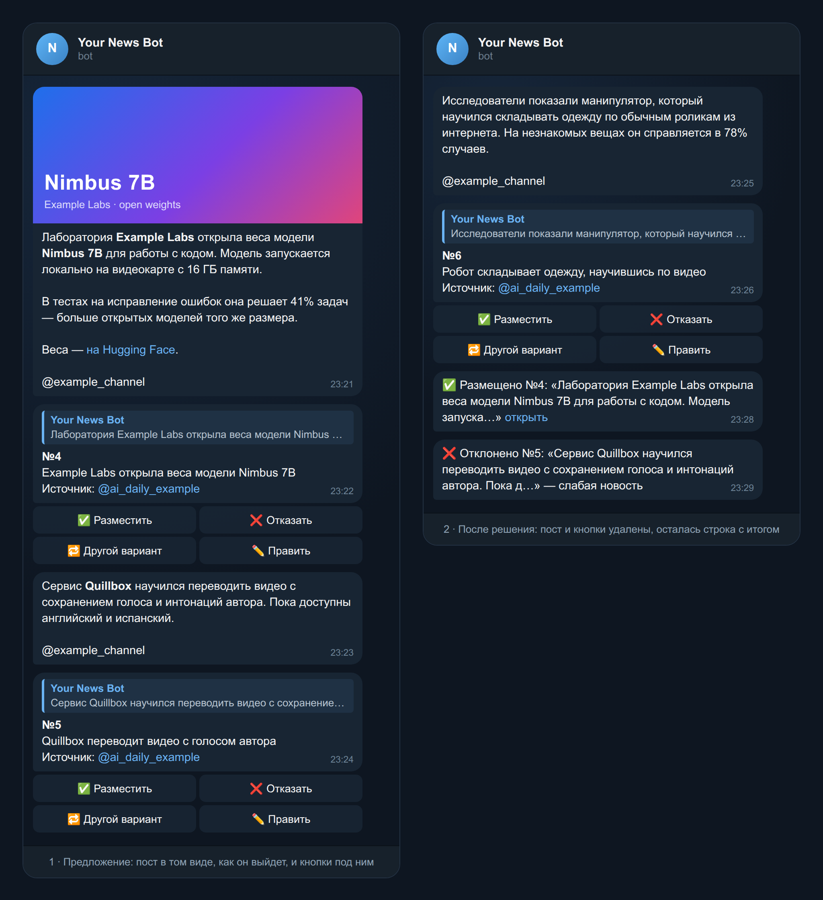
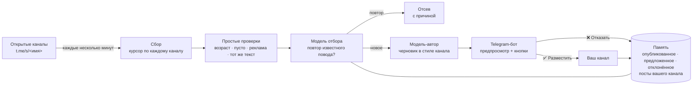
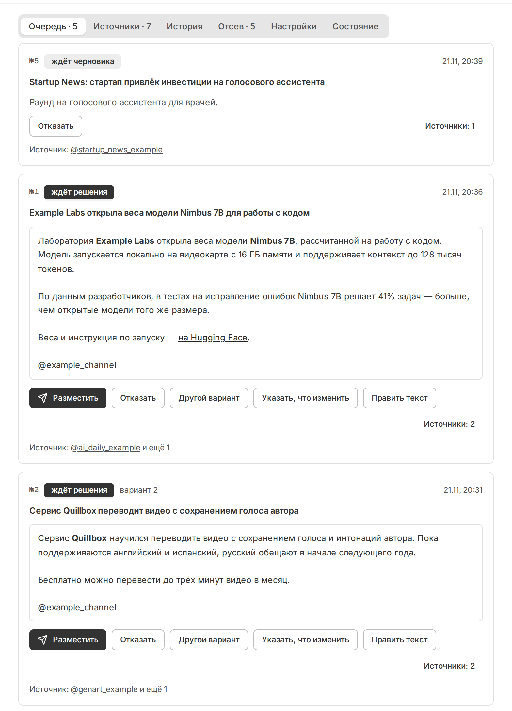
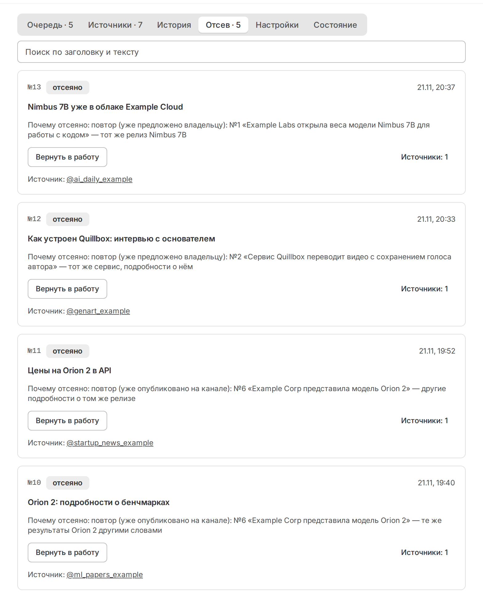
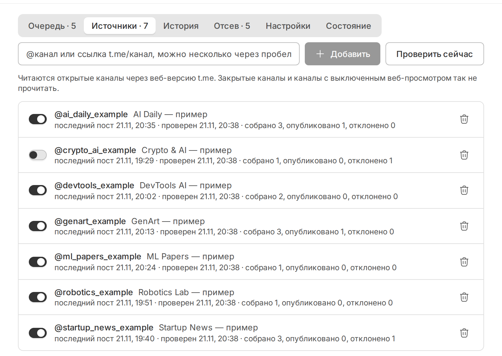
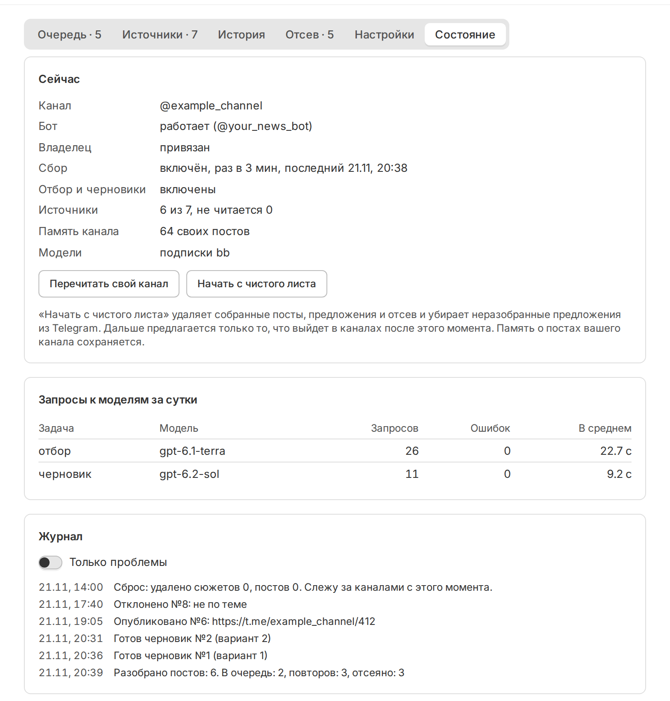
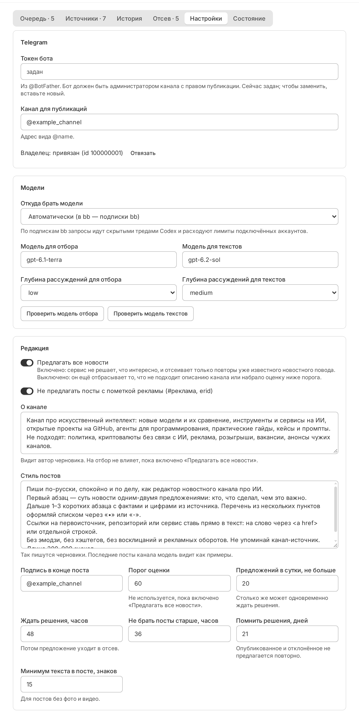
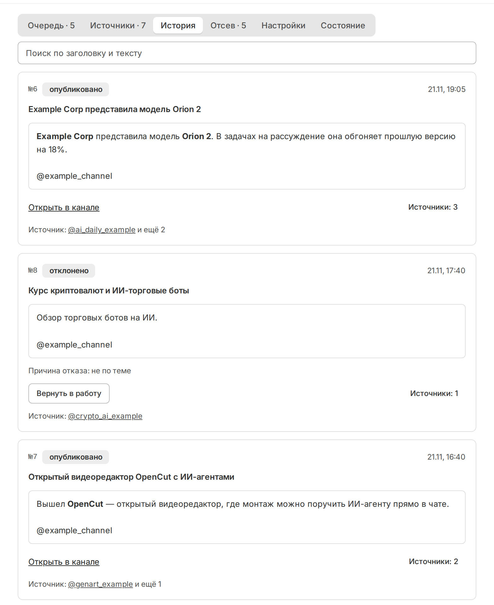

<div align="center">

# AiXenix Telegram Scrapper AI

**ИИ-редакция для вашего Telegram-канала.**
Следит за открытыми каналами, не предлагает повторно то, что у вас уже было, пишет посты в стиле вашего канала
и публикует их только после того, как вы нажмёте **«Разместить»** в Telegram-боте.

[](https://github.com/AiXenix/AiXenix-Telegram-Scrapper-AI/actions/workflows/ci.yml)
[](LICENSE)
[](https://nodejs.org/)
[](bb-plugin/)
[](standalone/)

[English](README.md) · **Русский**



<sub>Как бот общается с вами. Сообщения и кнопки сформировал сам сервис, чат отрисован как макет.</sub>

</div>

---

## Содержание

- [Что умеет](#что-умеет)
- [Как это работает](#как-это-работает)
- [Скриншоты](#скриншоты)
- [Два способа запуска](#два-способа-запуска)
- [Настройка Telegram (для обоих способов)](#настройка-telegram-для-обоих-способов)
- [Запуск как плагин bb](#запуск-как-плагин-bb)
- [Запуск отдельным скриптом (Windows, Linux, macOS)](#запуск-отдельным-скриптом-windows-linux-macos)
- [Все настройки](#все-настройки)
- [Каждый день](#каждый-день)
- [Безопасность и приватность](#безопасность-и-приватность)
- [Ограничения](#ограничения)
- [Если что-то не работает](#если-что-то-не-работает)
- [Разработка](#разработка)
- [Лицензия](#лицензия)

## Что умеет

| | |
|---|---|
| **Следит за каналами за вас** | Каждые несколько минут читает открытые каналы из вашего списка. По каждому каналу помнит, где остановился, поэтому после перезапуска ничего не теряется. Новый канал читается с момента добавления. |
| **Один новостной повод — одно предложение** | Если вы разместили «Example Corp выпустила модель X», посты других каналов о том же релизе (что модель умеет, сколько стоит, чьё-то мнение) повторно не предлагаются. Действительно новое событие про тот же продукт — предлагается. |
| **Не решает за вас, что интересно** | По умолчанию предлагается каждый новый повод: модели ищут только повторы. Кроме повторов пропускаются лишь устаревшие, пустые или очень короткие посты, посты с пометкой рекламы и репосты вашего же канала. Строгий режим с отбором по теме и оценке включается одним переключателем. |
| **Пишет в вашем стиле** | Черновики следуют вашей инструкции по стилю и последним постам канала, сохраняют ссылки и факты источника, добавляют вашу подпись. |
| **Решаете вы** | Каждый черновик приходит в бот ровно в том виде, в каком выйдет, с кнопками **✅ Разместить**, **❌ Отказать**, **🔁 Другой вариант** и **✏️ Править**. |
| **Чистый чат** | После решения пост и кнопки удаляются, остаётся одна строка с итогом. |
| **Ручной выбор** | Перешлите боту любой пост — он подготовит его вне очереди. Если такое уже есть на канале, бот скажет. |
| **Админка** | Очередь, источники, история, отсев с причинами, настройки и состояние на одной странице (в плагине bb). |
| **Два способа запуска** | Плагином внутри [bb](https://getbb.app) или одним файлом для Node.js. Код и файл настроек у них общие. |

## Как это работает



1. **Сбор.** Каждый источник читается через публичную веб-версию (`t.me/s/<канал>`). Аккаунт Telegram и сессии не используются.
2. **Простые проверки.** Без модели пропускаются посты старше `maxAgeHours`, посты без текста, очень короткие посты без медиа и посты с пометкой рекламы. Пост с текстом, слово в слово совпадающим с уже встречавшимся, записывается как его повтор.
3. **Проверка на повтор.** До 10 постов за раз уходят модели отбора вместе с заголовками недавних сюжетов (опубликованных, предложенных, отклонённых и постов вашего канала) и самыми похожими по общим словам и ссылкам. Модель отвечает «повтор сюжета №N» или «новое». Повтор попадает в отсев со строкой, что именно он повторяет.
4. **Черновик.** Модель-автор получает инструкцию по стилю, до шести последних постов вашего канала как образец и до четырёх постов источников о сюжете и пишет один пост в пределах лимитов Telegram (1024 знака под фото или видео).
5. **Предложение.** Бот присылает пост с медиа, а под ним сообщение с кнопками.
6. **Решение.** «Разместить» публикует пост в канал и запоминает его; «Отказать» предлагает указать причину. В обоих случаях в чате остаётся одна строка с итогом. Предложение без решения через 48 часов уходит в отсев.

## Скриншоты

Админка плагина bb, заполненная вымышленными демо-данными.

<table>
<tr>
<td width="50%">
<picture>
  <source media="(prefers-color-scheme: dark)" srcset="docs/images/queue-dark.png">
  
</picture>
<p align="center"><b>Очередь</b>: черновики ждут вашего решения</p>
</td>
<td width="50%">
<picture>
  <source media="(prefers-color-scheme: dark)" srcset="docs/images/filtered-dark.png">
  
</picture>
<p align="center"><b>Отсев</b>: у каждого повтора видно, что он повторяет</p>
</td>
</tr>
<tr>
<td width="50%">
<picture>
  <source media="(prefers-color-scheme: dark)" srcset="docs/images/sources-dark.png">
  
</picture>
<p align="center"><b>Источники</b>: добавить, приостановить, убрать</p>
</td>
<td width="50%">
<picture>
  <source media="(prefers-color-scheme: dark)" srcset="docs/images/status-dark.png">
  
</picture>
<p align="center"><b>Состояние</b>: бот, сбор, расход моделей, журнал</p>
</td>
</tr>
<tr>
<td width="50%">
<picture>
  <source media="(prefers-color-scheme: dark)" srcset="docs/images/settings-dark.png">
  
</picture>
<p align="center"><b>Настройки</b>: Telegram, модели, правила редакции</p>
</td>
<td width="50%">
<picture>
  <source media="(prefers-color-scheme: dark)" srcset="docs/images/history-dark.png">
  
</picture>
<p align="center"><b>История</b>: что вы опубликовали и отклонили</p>
</td>
</tr>
</table>

## Два способа запуска

| | Плагин bb | Отдельный скрипт |
|---|---|---|
| Папка | [`bb-plugin/`](bb-plugin/) | [`standalone/`](standalone/) |
| Где работает | внутри сервера [bb](https://getbb.app) | на любом компьютере с Node.js 22.13+ |
| Настройки | в админке или `bb newsdesk config import` | файл `newsdesk.config.json` рядом со скриптом |
| Модели | подписки, подключённые к bb (провайдер Codex), или любой API, совместимый с OpenAI | любой API, совместимый с OpenAI (OpenRouter, OpenAI, локальный сервер), или доступный вам сервер bb |
| Админка | есть | нет; то же самое делают бот и консольные команды |
| Прокси для Telegram | сеть самого сервера | `network.proxy` в настройках |

Выберите один. **С одним токеном бота может работать только одна копия**: Telegram отдаёт каждое нажатие кнопки только одной программе.

```
AiXenix-Telegram-Scrapper-AI/
├── bb-plugin/          # плагин bb и весь исходный код
│   ├── src/            # ядро, общее для обоих способов запуска
│   ├── server.ts       # оболочка bb: настройки, модели, API админки, `bb newsdesk`
│   ├── app.tsx         # админка
│   ├── standalone-src/ # оболочка отдельного скрипта и его сборка
│   └── tests/          # тесты и сквозной сценарий с имитацией Telegram
├── standalone/         # готовый скрипт: newsdesk.mjs, start.bat, start.sh, пример настроек
└── docs/images/        # скриншоты
```

## Настройка Telegram (для обоих способов)

1. **Создайте бота.** Откройте [@BotFather](https://t.me/BotFather), отправьте `/newbot` и скопируйте выданный токен.
2. **Сделайте бота администратором канала.** Канал → Администраторы → Добавить администратора → ваш бот, с правом **«Публикация сообщений»**. Если права нет, страница состояния предупредит.
3. **Впишите токен и канал в настройки** (см. разделы ниже). Канал пишется как `@ваш_канал`.
4. **Привяжите бота к себе.** Откройте бота и отправьте `/start <код>`. Шестизначный код показан на страницах «Состояние» и «Настройки», в выводе команды `status` и при запуске скрипта. После этого бот отвечает только вам.
5. **Добавьте каналы-источники**: `/add @канал` в боте, вкладка «Источники» или список `sources` в настройках.

Источники должны быть **открытыми каналами с включённым веб-просмотром**: сервис читает `https://t.me/s/<канал>`. Закрытые каналы так не прочитать.

## Запуск как плагин bb

Нужен bb 0.49 или новее.

**Установка**

```bash
bb plugin install git:https://github.com/AiXenix/AiXenix-Telegram-Scrapper-AI --subdirectory bb-plugin
```

или из клона:

```bash
git clone https://github.com/AiXenix/AiXenix-Telegram-Scrapper-AI.git
cd AiXenix-Telegram-Scrapper-AI/bb-plugin && npm install
bb plugin install .
```

**Настройка.** Откройте **«Редакция новостей»** в боковой панели bb → **«Настройки»**:

- **Telegram**: токен бота и канал. Токен хранится в секретных настройках плагина bb, а не в его базе и не в браузере.
- **Модели**: по умолчанию запросы идут скрытыми тредами bb на провайдере **Codex**, то есть на аккаунтах ChatGPT/Codex, подключённых к bb (`bb provider list`, `bb pool status`). Названия моделей — из `bb provider models codex`; по умолчанию быстрая модель для проверки повторов и сильная для текстов. Чтобы работать по ключу API, переключите источник моделей на «Свой ключ API» и укажите адрес и ключ.
- **Редакция**: подпись, инструкция по стилю, режим «Предлагать все новости», лимиты.

Затем привяжите бота (`/start <код>`) и добавьте источники.

**Консоль.** Всё доступно и командами, это удобно агентам в bb:

```bash
bb newsdesk status                      # что происходит и какие есть проблемы
bb newsdesk source add @канал ...       # добавить каналы (ещё: remove, pause, resume)
bb newsdesk queue                       # что ждёт решения
bb newsdesk show 12                     # черновик и источники сюжета №12
bb newsdesk publish 12                  # опубликовать сюжет №12 в канал
bb newsdesk reject 12 --reason "..."    # отклонить
bb newsdesk regenerate 12 --instruction "короче"   # попросить другой вариант
bb newsdesk reset --yes                 # начать с чистого листа, см. ниже
bb newsdesk config export               # все настройки в JSON, секреты скрыты
bb newsdesk config import /путь/к/newsdesk.config.json
bb newsdesk llm-test --which writer     # проверить, что модель отвечает
```

## Запуск отдельным скриптом (Windows, Linux, macOS)

Всё лежит в [`standalone/`](standalone/): один файл `newsdesk.mjs` (все зависимости внутри), запускалки и пример настроек. Нужен только **Node.js 22.13 или новее** ([nodejs.org](https://nodejs.org/)).

**Windows**

1. Скачайте `AiXenix-Telegram-Scrapper-AI-standalone-<версия>.zip` из [последнего релиза](https://github.com/AiXenix/AiXenix-Telegram-Scrapper-AI/releases/latest) и распакуйте куда угодно, например в `C:\newsdesk\`. (Или *Code → Download ZIP* на этой странице и возьмите из архива папку `standalone`.)
2. Скопируйте `newsdesk.config.example.json` в **`newsdesk.config.json` в той же папке**. Это единственный файл со всеми настройками.
3. Откройте его в Блокноте и заполните:
   - `telegram.botToken`: токен от @BotFather;
   - `telegram.channel`: `"@ваш_канал"`;
   - `sources`: каналы, за которыми следить;
   - `llm`: откуда брать модели (ниже);
   - `editorial.footer`: подпись под каждым постом или `""`.

   Затем проверьте: `newsdesk config check` перечислит все значения, которые остались заглушками или не смогут работать.
4. Дважды щёлкните **`start.bat`**. В окне появится код привязки: отправьте боту `/start <код>`. Окно не закрывайте; если сервис остановится, `start.bat` перезапустит его через 15 секунд.
5. Чтобы сервис стартовал вместе с Windows: нажмите <kbd>Win</kbd>+<kbd>R</kbd>, введите `shell:startup` и положите туда ярлык на `start.bat`.

Разовые команды работают, пока сервис запущен. Откройте консоль в этой папке (в Проводнике введите `cmd` в адресной строке и нажмите <kbd>Enter</kbd>) и выполните `newsdesk status`, `newsdesk add @канал`, `newsdesk queue`, `newsdesk publish 12`, `newsdesk help`. В PowerShell добавляйте `.\` в начале: `.\newsdesk status`.

**Linux и macOS**

```bash
cd standalone
cp newsdesk.config.example.json newsdesk.config.json   # затем отредактируйте
./start.sh                                             # или: node newsdesk.mjs run
```

**Модели для скрипта.** Один из вариантов:

- **Любой API, совместимый с OpenAI** (рекомендуется): `"backend": "openai"`, `"apiBaseUrl"` с `/v1` на конце и `"apiKey"`. Подходят [OpenRouter](https://openrouter.ai/keys) (`https://openrouter.ai/api/v1`), OpenAI (`https://api.openai.com/v1`) или локальный сервер вроде Ollama или LM Studio. В `filterModel` и `writerModel` укажите названия моделей этого поставщика. Параметры `*Reasoning` для этого варианта не передаются.
- **Сервер bb**: `"backend": "bb-remote"`, `"bbUrl"` и `"bbToken"` (из `bb plugin token newsdesk`). Тогда скрипт пользуется моделями плагина и подписками bb. Ему нужен прямой доступ к HTTP-порту сервера bb, например `http://127.0.0.1:38886` на той же машине или через вашу VPN; публичный адрес `*.getbb.app` требует входа в аккаунт и не подойдёт.

**Telegram заблокирован в вашей сети?** Укажите `network.proxy`: `"http://логин:пароль@адрес:порт"` или `"env"`, чтобы взять прокси из переменных `HTTPS_PROXY`/`HTTP_PROXY`.

Файл настроек перечитывается при изменении, его можно править на ходу; если в новой версии ошибка, сервис продолжит работать со старыми настройками (что не так, покажет `newsdesk config check`). История и память лежат в папке `data` рядом с настройками: чтобы перенести сервис на другой компьютер, скопируйте папку целиком.

## Все настройки

Один JSON-документ, общий для обоих способов запуска. Отсутствующие поля берут значения по умолчанию, поэтому в файле можно оставить только то, что отличается. Поля с 🔒 — секреты.

<details open>
<summary><b>telegram</b></summary>

| Поле | По умолчанию | Что значит |
|---|---|---|
| `botToken` 🔒 | `""` | Токен бота от @BotFather. |
| `channel` | `""` | Ваш канал, `@имя`. Бот должен быть его администратором с правом публикации. |
| `ownerChatId` | `null` | Ваш ID в Telegram. Заполняется командой `/start <код>`; `null` — привязать заново. |
| `apiBase` | `https://api.telegram.org` | Адрес Bot API. Меняйте только для локального сервера Bot API или тестов. |

</details>

<details open>
<summary><b>sources</b></summary>

Список каналов: `"@имя"`, ссылка `t.me` или `{ "handle": "@имя", "enabled": false }` для канала на паузе. Бот (`/add`, `/remove`, `/pause`, `/resume`) и админка правят этот список сами.

</details>

<details open>
<summary><b>llm</b></summary>

| Поле | По умолчанию | Что значит |
|---|---|---|
| `backend` | `auto` | `bb-threads` (подписки bb, только в плагине), `bb-remote` (сервер bb по HTTP), `openai` (любой API, совместимый с OpenAI) или `auto`: в плагине `bb-threads`, в скрипте `bb-remote`, если задан `bbUrl`, иначе `openai`. |
| `filterModel` | `gpt-6.1-terra` | Модель для проверки повторов. Хватит быстрой и недорогой. |
| `writerModel` | `gpt-6.2-sol` | Модель, которая пишет черновики. |
| `filterReasoning`, `writerReasoning` | `low`, `medium` | Глубина рассуждений для моделей bb. Для `openai` не используется. |
| `apiBaseUrl` | `""` | Для `openai`: адрес с `/v1` на конце. |
| `apiKey` 🔒 | `""` | Для `openai`. |
| `bbUrl` | `""` | Для `bb-remote`: адрес сервера bb. |
| `bbToken` 🔒 | `""` | Для `bb-remote`: `bb plugin token newsdesk`. |
| `workerProjectId` | `null` | Проект bb для скрытых тредов моделей; `null` — личный проект. |

Названия моделей по умолчанию — это модели провайдера Codex в bb. С другим источником моделей указывайте названия вашего поставщика.

</details>

<details open>
<summary><b>editorial</b></summary>

| Поле | По умолчанию | Что значит |
|---|---|---|
| `proposeAll` | `true` | Предлагать каждый новый повод; модели ищут только повторы (простые проверки выше действуют и так). `false` — ещё отбрасывать то, что не подходит `channelProfile` или набрало меньше `minScore`. |
| `skipAds` | `true` | Не предлагать посты с пометкой рекламы (`#реклама`, `erid`). |
| `channelProfile` | канал про ИИ | О чём ваш канал. Автор черновиков видит это всегда, отбор — только при `proposeAll: false`. |
| `styleGuide` | нейтральный новостной стиль | Как писать посты. На любом языке, черновики будут ему следовать. |
| `footer` | `""` | Подпись последней строкой каждого поста, например `"@ваш_канал"`. |
| `minScore` | `60` | Порог оценки (0–100) при `proposeAll: false`. |
| `minTextLength` | `15` | Посты без медиа и с текстом короче этого пропускаются. |
| `maxAgeHours` | `36` | Посты старше этого на момент сбора пропускаются. |
| `memoryDays` | `21` | Сколько дней сюжеты защищают от повторов. |
| `maxProposalsPerDay` | `20` | Черновиков в сутки и сколько предложений может ждать решения одновременно. |
| `proposalTtlHours` | `48` | Через столько часов без решения предложение уходит в отсев. |

</details>

<details open>
<summary><b>schedule</b> и <b>network</b></summary>

| Поле | По умолчанию | Что значит |
|---|---|---|
| `schedule.pollMinutes` | `3` | Как часто проверять каналы. |
| `schedule.collectEnabled` | `true` | Собирать новые посты. |
| `schedule.pipelineEnabled` | `true` | Проверять повторы и писать черновики. |
| `network.proxy` | `""` | Только для скрипта: `""`, `"env"` или `"http://логин:пароль@адрес:порт"`. |

</details>

**Перенос между bb и скриптом.** `bb newsdesk config export --with-secrets > newsdesk.config.json` даёт файл, который скрипт примет как есть; `bb newsdesk config import <файл>` загружает настройки скрипта в bb. Перед запуском одного остановите другой.

## Каждый день

**В боте**

| Команда или действие | Что происходит |
|---|---|
| ✅ **Разместить** | Пост уходит в канал, в чате остаётся `✅ Размещено №N: «…» открыть`. |
| ❌ **Отказать** | Появляются кнопки причины (по желанию), в чате остаётся `❌ Отклонено №N: «…» — причина`. |
| 🔁 **Другой вариант** | Новый черновик заменяет старый. |
| ✏️ **Править** | Напишите, что изменить («короче», «добавь ссылку на репозиторий»), или пришлите свой текст: жирный и ссылки сохранятся. |
| Переслать любой пост | Готовится вне очереди. Если уже опубликован, бот скажет. |
| `/status`, `/queue`, `/sources` | Состояние, ожидающие предложения (присылаются заново), список источников. |
| `/add @канал`, `/remove @канал`, `/pause @канал`, `/resume @канал` | Управление источниками. |
| `/collect` | Проверить каналы сейчас. |

**Начать с чистого листа.** Кнопка «Начать с чистого листа» на вкладке «Состояние», `bb newsdesk reset --yes` или `newsdesk reset --yes` забывают собранные посты, предложения, отсев и историю, удаляют из чата неразобранные предложения и переводят каждый источник на его последний пост. Дальше предлагается только то, что выйдет после этого. Опубликованное остаётся в памяти как посты вашего канала, его повторы по-прежнему узнаются; отклонённые сюжеты удаляются, поэтому отклонённые раньше новости могут прийти снова.

## Безопасность и приватность

- **В репозитории нет секретов.** Здесь нет токенов, ключей, сессий Telegram, ID чатов и личных списков каналов. Тесты работают на вымышленных данных и имитации Telegram. В примере настроек только заглушки.
- **Никогда не публикуйте `newsdesk.config.json` и папку `data/`.** Их уже исключает [`.gitignore`](.gitignore), вместе с `*.session`, `*.db` и `.env`.
- **Где хранятся секреты.** В bb: токен бота, ключ API и токен bb — секретные настройки плагина; при выгрузке они заменяются на `***`, если не указать `--with-secrets`. В скрипте: открытым текстом в `newsdesk.config.json`. Держите эту папку закрытой; на Linux/macOS выполните `chmod 600 newsdesk.config.json` (сам сервис, перезаписывая файл, оставляет доступ только владельцу).
- **Аккаунт Telegram не используется.** Каналы читаются через публичную веб-версию, утекать нечему.
- **Нажимать кнопки можете только вы.** Бот отвечает только привязанному владельцу. На каждой кнопке метка копии сервиса, которая её прислала, поэтому вторая копия не сможет решить судьбу сюжетов первой.
- **Входные данные для модели — это данные.** Посты передаются в запросах как материал, модели запрещено выполнять указания из них, а её ответ перед отправкой очищается до HTML, который принимает Telegram.
- **HTTP-маршруты плагина требуют токен плагина** (`x-bb-plugin-token`).

Нашли уязвимость? См. [SECURITY.md](SECURITY.md).

## Ограничения

- Читаются только открытые каналы с включённым веб-просмотром.
- Видео, которые Telegram не отдаёт в веб-версии, не прикладываются; в предложении об этом будет пометка, пост уйдёт текстом.
- Сервис опирается на разметку `t.me/s/`. Если Telegram её поменяет, разбор страницы придётся обновить (он покрыт тестами на сохранённой странице).
- Админка, бот и вывод скрипта в консоли — на русском. Встроенные запросы к моделям тоже на русском, поэтому заголовки сюжетов в очереди и истории русские. Описание канала и инструкция по стилю могут быть на любом языке, черновики следуют инструкции.
- Ваш собственный канал тоже читается через веб-версию. Если он закрытый, публиковать это не мешает, но посты, опубликованные вручную, не попадут в память повторов.
- Один токен бота — одна работающая копия.

## Если что-то не работает

| Признак | Что делать |
|---|---|
| «Этого бота уже опрашивает другая программа» | Тот же токен использует вторая копия сервиса или старый скрипт бота. Остановите её. |
| «Бот не может публиковать…» / «Бот не добавлен…» | Сделайте бота администратором канала с правом «Публикация сообщений». |
| У источника «не найден или у него выключен веб-просмотр» | Канал закрытый, переименован или у него выключен веб-просмотр. |
| Давно нет предложений | После сброса это нормально: считаются только новые посты. `status` покажет время последнего сбора, `collect` проверит каналы сейчас. |
| `status` пишет, что сервис не запущен (скрипт) | Запустите `start.bat` или `start.sh`; `status` читает то, что сохранила работающая копия, и замечает, когда она остановилась. |
| `config check` перечисляет заглушки | Замените все `PASTE_…`, `MODEL_FOR_…` и каналы из примера своими значениями. |
| Ошибки модели, конвейер на паузе | `llm-test` покажет точную ошибку. В bb проверьте `bb pool status`; с API — ключ, адрес и названия моделей. |
| Telegram недоступен (скрипт) | Укажите `network.proxy`. |

## Разработка

Весь код лежит в [`bb-plugin/`](bb-plugin/). Ядро в `src/` не знает, где оно работает: хранилище, настройки, HTTP и модели ему дают `server.ts` (bb) и `standalone-src/main.ts` (скрипт).

```bash
cd bb-plugin
npm ci
npm run check                                   # TypeScript
npm test                                        # тесты и сквозной сценарий с имитацией Telegram
npm run build:standalone -- ../standalone       # пересобрать отдельный скрипт
bb plugin build                                 # собрать плагин
```

`tests/e2e/live-scenario.mjs` проходит сценарий владельца на работающей копии (плагине или скрипте), бот которой подключён к имитации Telegram из `tests/support/mock-telegram.mjs`, с настоящими каналами и моделями. Как его запустить — в [CONTRIBUTING.md](CONTRIBUTING.md#живой-сценарий).

## Лицензия

[MIT](LICENSE) © 2026 [AiXenix](https://aixenix.com)
